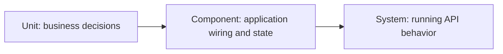
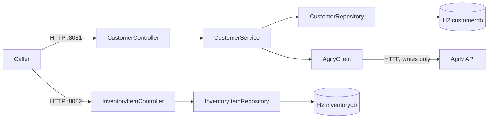
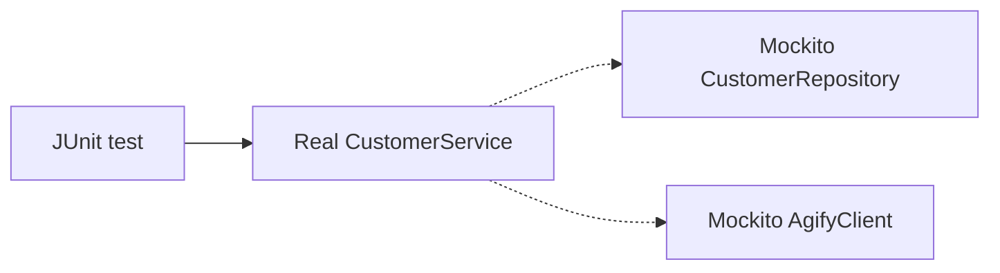
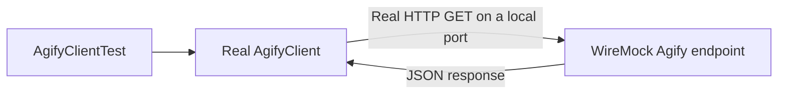
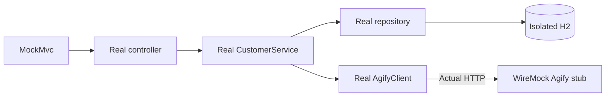
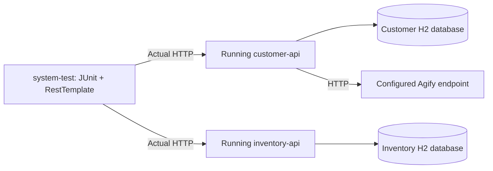
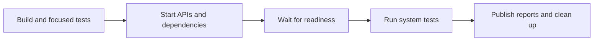

# 01. Testing the customer and inventory APIs

Unit, component, and system tests in the Maven demo



> Choose the boundary first. Then choose what is real and what is controlled.

<!-- Speaker notes
A walkthrough for Java and Spring developers. The examples come from pom-bom. The presentation describes the current implementation and explicitly identifies proposed additions. It does not treat every test executed by mvn test as a unit test.
-->

---

## 02. Two independent APIs, one external dependency



Each API owns its own in-memory database. The demo has no customer-to-inventory runtime call.

<!-- Speaker notes
CustomerController delegates to CustomerService. The service decides when to call Agify and when to persist. The inventory demo remains controller-to-repository; it has no service layer or downstream HTTP client. platform contains build-time POM/BOM artifacts, not running services. system-test is a separate Maven test project. The outbound HTTP call leaves the application through AgifyClient.
-->

---

## 03. Fetch age on writes. Read age from storage.

| Operation | Agify call | Database behavior |
| --- | --- | --- |
| POST customer | First-name lookup | Save returned age with the new customer |
| PUT customer | Fresh lookup, even if name is unchanged | Save fields and the refreshed age |
| GET / list | None | Return the previously saved age |
| DELETE | None | Remove the saved customer |

### Input boundary

`CustomerRequest` contains only `firstName`, `lastName`, and `email`. Age is added to the response after the Agify lookup.

### Failure boundary

A valid `null` age means unknown. A failed lookup produces HTTP 502 and leaves data unchanged.

References: [Agify API reference](https://agify.io/documentation/api/reference).

<!-- Speaker notes
AgifyClient performs GET with the name query parameter and an optional API key. CustomerService owns the transaction and applies enrichment before saving. A missing customer is detected before a lookup on update. A nullable Integer supports unknown ages and existing rows without age data. Failures include upstream errors, timeouts, and invalid response payloads. The dedicated request record excludes both generated ID and age from create/update input schemas.
-->

---

## 04. The test boundary determines what a pass proves

| Level | Application entry | Database | Downstream | Main proof |
| --- | --- | --- | --- | --- |
| Unit | Direct Java method | Mock repository | Mockito mock | Decisions and delegation |
| MVC slice | MockMvc | Outside scope | Mocked service boundary | Routing, JSON, validation |
| Repository slice | Repository method | Real H2 | Outside scope | JPA and persistence behavior |
| HTTP client | Real AgifyClient | Outside scope | WireMock over HTTP | Request/response contract |
| Component | MockMvc + full Spring | Real isolated H2 | WireMock over HTTP | Application wiring and saved state |
| System | HTTP to running APIs | Read through API | Environment configuration | Externally observable behavior |

> `mvn test` is an execution phase. It does not define a test’s scope.

References: [In-process component testing](https://martinfowler.com/articles/microservice-testing/fallback.html).

<!-- Speaker notes
These are team conventions rather than a universal taxonomy. A component test legitimately integrates several layers. The term in-process component test makes its application boundary explicit. AgifyClientTest is a focused HTTP client test, not a pure unit test, because WireMock opens a local listener and the real client sends HTTP. A *Test filename alone does not imply unit-test isolation.
-->

---

## 05. Unit tests keep the DB and HTTP outside the boundary



### Database

Stub repository results. Verify save/delete decisions and the values passed to the repository.

### Downstream

Stub `AgifyClient.getAge()`. Verify when it is called and when it must remain untouched.

<!-- Speaker notes
CustomerControllerTest mocks CustomerService and checks delegation plus HTTP response objects. CustomerServiceTest mocks CustomerRepository and AgifyClient. A mocked repository does not execute SQL. A mocked AgifyClient does not verify its URL, JSON decoding, authentication, or network behavior. Those concerns are intentionally exercised by repository and HTTP client tests.
-->

---

## 06. Service unit tests cover decisions and failure paths

### Examples already covered

- Derive age from the first name before saving.
- Refresh age on update, including the same first name.
- Store a valid unknown age as `null`.
- Read/list/delete without calling Agify.
- Do not save after an Agify failure.

### Focused interaction checks

```java
when(repository.findById(7L))
    .thenReturn(Optional.of(stored));

var customer = service.getById(7L);
JSONAssert.assertEquals(expectedJson,
    mapper.writeValueAsString(customer.orElseThrow()),
    JSONCompareMode.STRICT);
verifyNoInteractions(agifyClient);
```

Examples: `CustomerServiceTest` and `CustomerControllerTest`. Each scenario supplies only the stubs it needs.

<!-- Speaker notes
The excerpt shows a read scenario with a saved-customer fixture and expected JSON. The service tests also compare complete serialized customer JSON. On a failed update, they verify that the existing object was not partially changed. Mockito tests are especially useful for proving the absence of an unnecessary call. They cannot establish actual persistence or network compatibility.
-->

---

## 07. The MVC slice checks the public request shape

### Request

```json
{
  "firstName": "Ada",
  "lastName": "Lovelace",
  "email": "ada@example.com"
}
```

### Response from the stubbed service

```json
{
  "id": 9,
  "firstName": "Ada",
  "lastName": "Lovelace",
  "email": "ada@example.com",
  "age": 42
}
```

- `@WebMvcTest` runs the real controller with a mocked `CustomerService`.
- Verify routing, status, Location, whole response JSON, and the three-field CustomerRequest input.
- Invalid fields return 400 with no service call. Persistence and Agify are outside this slice.

References: [Spring MockMvc](https://docs.spring.io/spring-framework/reference/testing/mockmvc/overview.html).

<!-- Speaker notes
CustomerControllerMvcTest exercises JSON conversion and Jakarta validation through MockMvc. Calling a controller method directly does not run the MVC routing/validation machinery. Create/update deserialize to CustomerRequest, which has only firstName, lastName, and email. Customer responses still contain generated ID and Agify-derived age. The component suite also verifies that both OpenAPI request schemas reference the three-field request record. The response age is the canned service result in this MVC slice; the slice does not prove that Agify produced it.
-->

---

## 08. Database tests must execute the database behavior

| Boundary | What is real | What it can establish |
| --- | --- | --- |
| Mocked repository | Only the calling Java code | Correct repository interactions, not SQL |
| `@DataJpaTest` + H2 | JPA and the H2 engine | Mappings and persistence on the demo database |
| Component + H2 | Controller, service, repository, H2 | Saved state after an application request |
| Production-engine container | The selected database engine | Engine-specific queries and migrations; proposed addition |

### Persistence check pattern

```java
var saved = repository.save(customer);
entityManager.flush();
entityManager.clear();
var reloaded = repository.findById(saved.getId());
```

### Be precise about coverage

Flush and clear when proving a database round trip. The current repository slice is a simpler save/find test. A production-engine container is not configured in this demo.

References: [Spring Boot 3.5 testing](https://docs.spring.io/spring-boot/3.5/reference/testing/spring-boot-applications.html), [Testcontainers database support](https://java.testcontainers.org/modules/databases/).

<!-- Speaker notes
H2 is an actual in-memory SQL database, not a Mockito mock. The demo applications also use H2. The flush/clear snippet is a recommended strengthening for mapping and SQL-focused tests, not a claim that CustomerRepositoryTest already does it. @DataJpaTest is transactional by default; transaction rollback and data cleanup should be deliberate. If a future deployment uses a different database engine, add tests against that engine rather than assuming H2 behavior is identical.
-->

---

## 09. WireMock exercises the real downstream HTTP client



```java
AGIFY.stubFor(get(urlPathEqualTo("/"))
    .withQueryParam("name", equalTo("Ada"))
    .willReturn(okJson("""
        {"name":"Ada","age":42,"count":1234}
        """)));
```

Use a dynamic local port and a dummy key. Verify the method, path, query encoding, and request count.

References: [WireMock JUnit Jupiter](https://wiremock.org/docs/junit-jupiter/).

<!-- Speaker notes
AgifyClientTest now uses WireMock instead of MockRestServiceServer. It constructs the real production client with WireMock’s base URL. WireMock’s Jupiter extension manages startup, reset, and shutdown, and unmatched requests fail the test. HTTP is real, but the remote provider is a controlled local server. This verifies our client contract rather than public Agify availability.
-->

---

## 10. Control downstream failures without depending on a live API

| WireMock response | Client expectation | API behavior when used for a write |
| --- | --- | --- |
| Valid age, e.g. 42 | Return the age | Save and return 201 / 200 |
| Valid `age: null` | Return unknown age | Save `null`, not a guessed value |
| 401 / 429 / 500 | Raise `AgifyUnavailableException` | Return 502; keep data unchanged |
| Empty / malformed / missing age / negative age | Reject invalid response | Return 502; keep data unchanged |
| Delay longer than read timeout | Real timeout failure | Return 502; keep data unchanged |

> The current timeout test uses a 10.5-second delay against a 10-second read timeout, with a 20-second test limit.

<!-- Speaker notes
The client exception is translated to HTTP 502 at the API boundary through AgifyUnavailableException. The HTTP client itself does not return a customer response. WireMock lets each failure be reproduced deterministically. Keep authentication/query-string secrets redacted in logs. The tests do not consume live Agify quota or require a developer key.
-->

---

## 11. Component tests keep the application layers real



### Inside the application

Spring wiring, JSON, validation, transactions, JPA, and saved state.

### At the external boundary

WireMock supplies deterministic responses to the real client. No public Agify dependency.

References: [Spring Boot 3.5 testing](https://docs.spring.io/spring-boot/3.5/reference/testing/spring-boot-applications.html).

<!-- Speaker notes
CustomerApiComponentTest combines @SpringBootTest with @AutoConfigureMockMvc, a dedicated H2 database, and the real AgifyClient pointed at WireMock through DynamicPropertySource. No customer HTTP server is started by the default SpringBootTest web environment. WireMock does start its own local HTTP server. The class closes its Spring context at the end so a cached client does not retain the URL of a stopped WireMock server.
-->

---

## 12. One lifecycle proves the state transitions

### One JUnit test, private step helpers

```java
@Test
void customerLifecycle() throws Exception {
    createCustomer();
    listCustomer();
    enquiryCustomer();
    updateCustomer();
    enquiryCustomer();
    deleteCustomer();
}
```

### Expected cumulative Agify requests

| Step | Calls | Stored age |
| --- | --- | --- |
| Create Ada | 1 | 42 |
| List | 1 | 42 |
| Enquiry | 1 | 42 |
| Update to Grace | 2 | 55 |
| Enquiry | 2 | 55 |
| Delete | 2 | Removed |

> Verify the count after every step. Stable response data alone cannot prove that no extra lookup occurred.

<!-- Speaker notes
The sequence is ordinary method execution inside one test, not JUnit ordering across independent tests. Each private helper begins with a step banner. Create and update compare known WireMock values with the complete response JSON and persisted entity JSON. List/enquiry/delete assert that the total request count did not increase. A failed step prevents later steps in the method, so cleanup must not depend only on the final delete.
-->

---

## 13. Negative cases protect data as well as status codes

| Scenario | Expected result | State / call assertion |
| --- | --- | --- |
| Invalid input | 400 | No persistence change and no downstream call |
| Missing customer | 404 | No lookup on an update/delete of a missing ID |
| Three-field create/update request | 201 / 200 | Response age is added from the downstream result |
| Agify unavailable during create | 502 | No new row |
| Agify unavailable during update | 502 | Original JSON and age remain unchanged |

Keep negative scenarios independent in a separate class, so one failure does not hide another.

> Current implementation: the positive component lifecycle uses WireMock. The separate negative Spring class still mocks AgifyClient.

<!-- Speaker notes
CustomerControllerNegativeIntegrationTest covers missing records, validation, failed create, and failed update using a real Spring context and real repository but a Mockito AgifyClient. AgifyClientTest independently proves HTTP failure handling with WireMock. Moving HTTP failure stubs into a negative component class would extend the combined HTTP-plus-transaction proof; that conversion is not currently implemented. Do not imply all existing negative component paths already use WireMock.
-->

---

## 14. System tests cross the application’s real HTTP boundary



- The suite calls public endpoints and checks status, headers, JSON, and subsequent reads.
- It does not inspect repositories or import the application’s implementation classes.

<!-- Speaker notes
CustomerApiSystemTest and InventoryApiSystemTest live in the independent system-test Maven project. The default base URLs are localhost:8081 and localhost:8082. The applications are separate running processes in the demonstrated verification environment. The downstream may be public Agify or a controlled endpoint selected through AGIFY_BASE_URL. The test suite must not claim it verified live third-party integration if a local stub supplied those responses.
-->

---

## 15. The harness starts servers. The suite only calls them.

### What the repository does

- Component/client tests start their WireMock instances automatically.
- `system-test` requires both APIs to be running first.
- Its Maven test lifecycle does not start or stop the APIs.

### How the demonstrated system run passed

- Temporary APIs were started on ports 18081 and 18082.
- A local Agify server supplied controlled responses.
- The suite ran, cleanup was checked, then all servers stopped.

```sh
mvn -f system-test/pom.xml test \
  -Dcustomer.base-url=http://localhost:18081 \
  -Dinventory.base-url=http://localhost:18082
```

That temporary orchestration was external to the suite. A fresh `mvn test` in system-test still needs running APIs.

<!-- Speaker notes
This distinction explains the earlier successful report even though the user had not started servers. The verification task launched them temporarily; there is no committed automatic application-startup harness inside system-test. For local use, start the two APIs in separate terminals. For CI, own startup, readiness, publication, and shutdown in the pipeline. Live Agify requires suitable configuration; build-time WireMock tests use dummy credentials.
-->

---

## 16. Run fast checks first, then exercise the environment



### Existing Maven commands from pom-bom

```sh
mvn -f platform/pom.xml install
mvn -f customer-api/pom.xml test
mvn -f inventory-api/pom.xml test
# Start the API processes separately.
mvn -f system-test/pom.xml test
```

### Recommended pipeline responsibilities

- Use isolated databases and controlled downstreams.
- Fail if readiness or system checks fail.
- Publish reports and logs on every outcome.
- Stop resources in a finally/always stage.

<!-- Speaker notes
The first three Maven commands work without starting the application servers manually; WireMock is managed by its tests. JDK 21 or newer is required by the demo build. The CI orchestration shown here is a recommendation rather than an existing pipeline file. The restricted verification environment supplied Mockito as a Java agent; environment-specific JVM options are runner configuration, not a change to the test boundary.
-->

---

## 17. Whole JSON and deliberate cleanup keep tests trustworthy

### Assert the contract

```java
ObjectNode expected =
    (ObjectNode) objectMapper.readTree(customerJson);
expected.put("id", customerId);
expected.put("age", 42); // Known WireMock value

JSONAssert.assertEquals(
    expected.toString(),
    actual.toString(),
    JSONCompareMode.STRICT);
```

### Protect isolation

- Use Java JSON text blocks for fixtures.
- Compare the complete expected object.
- Use unique emails/SKUs against shared APIs.
- Reset only dedicated component databases.
- AfterEach deletes only system-test-created IDs.

> An HTTP server transaction is separate from the test client. A test-side rollback does not clean up remote writes.

References: [Spring Boot 3.5 testing](https://docs.spring.io/spring-boot/3.5/reference/testing/spring-boot-applications.html).

<!-- Speaker notes
The excerpt assumes actual is a parsed JSON response and uses a known WireMock age. In system tests, generated ages are captured from the write response and required to remain stable on list/enquiry. Exact predicted values are established by client/component tests with known WireMock responses. The system suite finds its own record in a list instead of assuming an otherwise empty database. It buffers HTTP response bodies so logging does not consume content required by assertions.
-->

---

## 18. Every result links to a test-specific log

### Open after mvn test

```text
target/test-reports/index.html

target/test-reports/runs/<run-id>/
  index.html
  logs/<test-case>.log

target/surefire-reports/
  TEST-*.xml
  *-output.txt
```

### Inside one lifecycle log

```text
=====createCustomer=====
REQUEST  method=POST URL=... headers=... body=...
RESPONSE status=201 body=... durationMs=...
...
=====deleteCustomer=====
TEST RESULT [...] PASSED durationMs=...
```

- Refresh the report while the run progresses. Each parameterized invocation has a separate entry.
- Final results include setup/cleanup failures. Earlier runs remain under target until mvn clean.

<!-- Speaker notes
The HTML report is produced by the test reporting extension rather than an extra Maven reporting command. One grouped lifecycle is one case and one log, containing all step messages. Per-case logs contain correlated execution messages. Surefire class-output files retain Spring startup and background-thread output. The final pass is recorded after cleanup, so a passing assertion followed by a cleanup error is reported as failed. Logging redacts API-key query values and sensitive headers.
-->

---

## 19. The demo’s coverage has clear limits

### Implemented and demonstrated

- Controller/service decisions and MVC validation.
- JPA/H2 repository and component state checks.
- WireMock client contract and positive component flow.
- Real HTTP system CRUD against running APIs.
- 53 customer + 28 inventory + 12 system cases in the latest verified run.

### Add when the risk requires it

- Production-engine DB tests if deployment moves beyond H2.
- Migration, constraint, and concurrency checks.
- WireMock-based negative component failure paths.
- A separately configured live-provider smoke check.
- Cross-service business flows if the APIs become connected.

A pass against H2 and a local Agify stub does not establish production-database compatibility or live Agify availability.

References: [Testcontainers database support](https://java.testcontainers.org/modules/databases/).

<!-- Speaker notes
The 93-case count is the latest demonstrated run as of 25 November 2026, not a permanent target or a coverage percentage. The system verification used temporary local API instances plus a controlled local Agify server. There is currently no cross-service business transaction to test. Proposed additions should be driven by the deployed architecture and observed risk, not by a desire to duplicate every assertion at every layer.
-->

---

## 20. Use names that tell the reader what is real

| Question | Start with | Suggested name |
| --- | --- | --- |
| Is the Java decision correct? | Unit test + Mockito | CustomerServiceTest |
| Is the route/request contract correct? | MVC slice | CustomerControllerMvcTest |
| Does persistence work on the test engine? | Repository slice | CustomerRepositoryTest |
| Does our HTTP client handle the provider contract? | Real client + WireMock | AgifyClientTest |
| Do the application layers work together? | Full Spring + H2 + WireMock | CustomerApiComponentTest |
| Does the running API behave correctly? | HTTP system test | CustomerApiSystemTest |

> Document the entry point, database, and downstream boundary. The class suffix alone is not enough.

<!-- Speaker notes
Keep unit tests plentiful for isolated decisions, then add focused client/slice checks and representative component/system flows. Component testing is the chosen naming convention for the full application running in-process with isolated dependencies. It is still legitimate to describe the work as integrating layers. Existing legacy IntegrationTest names remain in the demo; do not infer a different boundary just from the suffix.
-->

---

## 21. Demo files and supporting references

### Where to start in this repository

- `customer-api/src/main/java/com/demo/customer/`: controller, request record, service, client, and entity.
- `customer-api/src/test/java/com/demo/customer/`: unit, slice, client, component, and negative cases.
- `inventory-api/src/test/java/com/demo/inventory/`: independent CRUD test examples.
- `system-test/src/test/java/com/demo/systemtest/`: real HTTP lifecycles.
- `*/src/test/java/com/demo/testsupport/`: logging and HTML reporting.

### Primary references

- [Spring Boot testing](https://docs.spring.io/spring-boot/3.5/reference/testing/spring-boot-applications.html)
- [Spring MockMvc](https://docs.spring.io/spring-framework/reference/testing/mockmvc/overview.html)
- [WireMock JUnit Jupiter](https://wiremock.org/docs/junit-jupiter/)
- [Testcontainers databases](https://java.testcontainers.org/modules/databases/)
- [Agify API](https://agify.io/documentation/api/reference)
- [In-process component testing](https://martinfowler.com/articles/microservice-testing/fallback.html)

<!-- Speaker notes
The Markdown and HTML companions contain the same slide content. HTML supports arrow keys, Page Up/Down, Home/End, a slide index, speaker notes, fullscreen, and browser printing. It loads no external fonts, scripts, or diagram libraries. Repository paths are relative to pom-bom. Primary documentation explains framework behavior; implementation-specific claims come from the demo source and the verified runs.
-->
